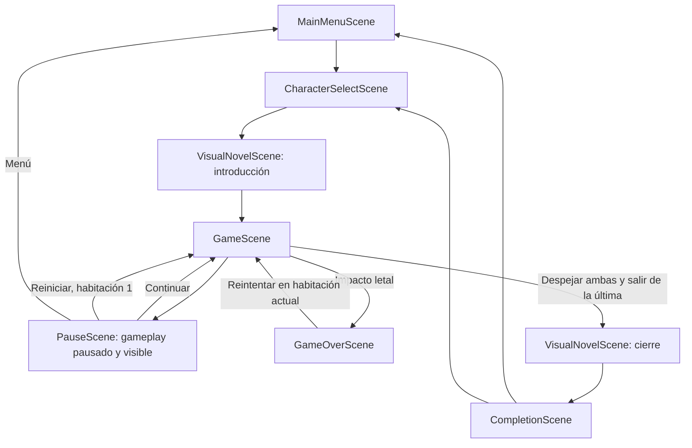

# Sprint 5 — Presentación narrativa, identidad visual e integración arcade

## Entrega

S5-01 a S5-08 implementadas y verificadas. El juego inicia en un menú principal, conserva el selector con códigos independientes, presenta la introducción de Alex o Lua, permite pausar el arcade y muestra una conclusión personalizada después de ganar. La derrota continúa pasando por su animación y Game Over.

El canvas ahora utiliza **todo el viewport** mediante Phaser Scale.RESIZE. La UI se adapta a esas dimensiones y la cámara amplía la habitación completa hasta el espacio disponible, manteniendo su proporción y reservando espacio para los controles. No se estiran sprites ni se recorta el mapa. El menú ofrece pantalla completa cuando el navegador admite esa API.

La referencia suministrada guía el diálogo inferior semitransparente, los menús verticales, los acentos suaves y el cierre centrado. Se reutilizan las ilustraciones originales de Alex/Lua y sus fondos existentes; no se generó ni reemplazó arte definitivo. Los textos siguen identificados como provisionales.

## Backlog y aceptación

| Historia | Resultado |
|---|---|
| S5-01 Consolidar narrativa | Motor existente reutilizado, typewriter, completar/avanzar, omitir y destinos tipados |
| S5-02 Estilo minimalista | UITheme compartido, diálogo inferior, fondos a pantalla completa, menús y estilos adaptables |
| S5-03 Introducciones independientes | Dos guiones de contexto arcade provisionales, permisos y personaje conservados |
| S5-04 Conclusión | Ruta correcta, fondo/ilustración originales, menú y elección de personaje; solo tras victoria |
| S5-05 Pausa | Esc o botón; continuar, reiniciar partida, menú; gameplay visible y detenido detrás |
| S5-06 Integración | Sesión arcade, habitaciones despejadas, victoria/derrota separadas, destinos configurables |
| S5-07 Recursos visuales | Catálogo existente, caché de imágenes decodificadas y guardas en precarga de texturas |
| S5-08 Pruebas/documentación | 370 comprobaciones aprobadas, build correcto, informe y este manual |

## Flujo y responsabilidades



Se conserva el nombre VisualNovelScene por compatibilidad con el motor anterior; su función es presentar secuencias breves del arcade. No es un modo independiente de juego. No se crearon otro intérprete, otra selección ni otro sistema de desbloqueos.

### Partida y victoria

ArcadeRunService es un servicio en el registro del juego, con identidad de sesión, personaje, conjunto de habitaciones despejadas y estado playing/defeat/victory. No usa localStorage. GameScene continúa controlando enemigos, colisiones, disparos y salas, y registra el evento ROOM_CLEARED existente.

La salida exige que no queden robots vivos en la habitación. Despejarla por sí solo no cambia de escena. Para ganar hay que despejar ambas habitaciones y usar la salida de la última. La segunda habitación de prueba ya estaba vacía y se mantiene así: se registra despejada al entrar. No se añadieron enemigos ni mapas.

La victoria produce un resultado de sesión válido y entra en alex_ending o lua_ending con destino completion. CompletionScene y la escena narrativa comprueban ese resultado y el desbloqueo. Pasar únicamente `{ character, runId }` a una escena no fabrica una victoria. Elegir menú u otro personaje consume el resultado. Esto es una guarda funcional de cliente, no una protección contra manipulación de herramientas del navegador.

Un impacto enemigo sigue matando inmediatamente. La derrota marca la sesión y conserva el flujo previo. Reintentar desde Game Over conserva la habitación y los despejes anteriores de esa sesión; los robots de la habitación actual se reconstruyen. Reiniciar partida desde pausa comienza en la primera habitación con progreso arcade nuevo. Ninguno de esos caminos borra los códigos o el progreso narrativo existente.

### Pausa y recursos

GameScene se pausa mediante el sistema de escenas de Phaser; no se oculta. Su actualización, física, animaciones y temporizadores quedan detenidos. PauseScene se ejecuta por encima con un menú DOM independiente. La prueba mantiene una bala pausada más de dos segundos y comprueba que tampoco vence su temporizador.

Continuar libera la superposición y restablece las teclas, evitando movimiento o disparo arrastrado. Se descuenta el tiempo de pausa al reloj utilizado por la IA. Esc funciona incluso al quitar el foco de los botones. Flechas arriba/abajo, Home/End, Tab, Enter, espacio y ratón permiten navegar el menú. Cada cierre retira listeners, DOM y capturas de teclado correspondientes.

No se cambian trayectorias, velocidades de robots, detección, colisiones ni reglas de impactos. Se conservan las habilidades del Sprint 4: Alex elimina la habitación mostrando bolas verdes sobre los enemigos, sin emitir proyectiles especiales; Lua usa electricidad. Los indicadores se mantienen legibles al ajustar el zoom de la cámara.

## Archivos agregados

| Archivo | Responsabilidad |
|---|---|
| src/config/UITheme.ts | Paleta, fuente y variables de presentación compartidas |
| src/systems/ArcadeRunService.ts | Sesión arcade, despejes y resultado de victoria/derrota |
| src/scenes/MainMenuScene.ts | Entrada al selector, reinicio de sesión arcade y pantalla completa opcional |
| src/scenes/PauseScene.ts | Superposición operativa con gameplay pausado |
| src/scenes/CompletionScene.ts | Conclusión personalizada y navegación con resultado validado |
| src/ui/MenuView.ts | Componente de menú y navegación de foco reutilizable |
| src/ui/presentation.css | Estilo de menú, pausa y conclusión con variantes adaptables |
| src/narrative/VisualAssetCache.ts | Cargas compartidas de ilustraciones originales; errores reintentables |
| src/narrative/PortraitFrameRenderer.ts | Recortes de expresiones en memoria, caché y alineación sobre un lienzo común |
| src/narrative/routes/alex/ending.ts | Secuencia provisional de cierre de Alex |
| src/narrative/routes/lua/ending.ts | Secuencia provisional de cierre de Lua |
| tests/sprint-5.html, sprint-5.browser.js, run-sprint-5.mjs | Integración, pausa, resultados válidos, entradas nativas y resoluciones |
| docs/test-results/sprint-5.json | Informe generado por la suite completa |

## Archivos modificados

| Archivo | Motivo |
|---|---|
| src/config/gameConfig.ts | MainMenuScene inicial, escenas nuevas y Scale.RESIZE |
| index.html | Contenedor de viewport completo y canvas sin separación de línea |
| src/scenes/GameScene.ts | Salidas con habitación despejada, resultado final, pausa, HUD y cámara adaptable |
| src/scenes/GameOverScene.ts | Transportar runId al reintentar y preservar progreso arcade |
| src/scenes/CharacterSelectScene.ts y src/ui/CharacterSelectView.ts | Volver al menú desde el selector |
| src/ui/character-select.css | Selector adaptable a todo el viewport y fuente compartida |
| src/ui/mountSceneView.ts | Tema compartido y actualización de dimensiones con limpieza del listener resize |
| src/ui/VisualNovelView.ts y visual-novel.css | Presentación narrativa discreta a pantalla completa y controles adecuados al destino |
| src/narrative/NarrativeTypes.ts | Destinos game/completion y transporte opcional de sesión |
| src/narrative/startNarrative.ts | Conservar identidad arcade cuando se solicita narrativa desde gameplay |
| src/scenes/VisualNovelScene.ts | Guardar introducciones, validar resultados y ejecutar destino; cierres no sobrescriben introducción |
| src/narrative/NarrativeRouteManager.ts | Registrar ambos cierres conservando los IDs de introducción existentes |
| src/narrative/routes/*/testSequence.ts | Diálogos breves propios del arcade con neutral y determinación |
| src/narrative/BackgroundManager.ts | Consumir caché compartida sin callbacks obsoletos tras salir |
| src/systems/PlayerAnimations.ts y src/abilities/SpecialAbilityManager.ts | Evitar precargas redundantes y adaptar HUD al zoom |
| src/config/GameSettings.ts y src/world/RoomBuilder.ts | Ocultar depuración física y marcadores rojos de spawn por defecto; siguen configurables |
| tests/selection.browser.js | Probar selector de forma aislada y adaptar texto/ruta al nuevo flujo |
| tests/combat.browser.js | Validar salida con despeje y cierre final en lugar del antiguo bucle de salas |
| tests/browser-session.mjs, tests/run-all.mjs y package.json | Suite conjunta Sprint 5, tiempo de espera configurable e informe propio |

## Manual de configuración

### Diálogos e introducciones

Las introducciones conservan los IDs alex_test y lua_test para no invalidar los checkpoints del Sprint 4. Sus archivos están en `src/narrative/routes/<personaje>/testSequence.ts`.

```ts
{ type: "dialogue", speaker: "Alex", speakerId: "alex", text: "Arma lista. Busco la salida." }
```

Agregar una instrucción dialogue no requiere editar la escena. Para otra secuencia, definir NarrativeSequence con id, route, chapterId, provisional y entries; registrarla en NarrativeRouteManager. Para cambiar el guion de entrada predeterminado, cambiar el primer guion registrado de esa ruta o pasar sequenceId explícitamente. No reutilizar IDs para esquemas de instrucciones incompatibles sin considerar los checkpoints guardados.

### Fondos y personajes

`src/config/NarrativeConfig.ts` sigue siendo el catálogo de recursos. Los cinco fondos dedicados de `public/assets/backgrounds/` ya están conectados, sin modificar los PNG originales:

| Clave | Imagen | Uso |
|---|---|---|
| main-menu | main-menu-background.png | Menú principal |
| alex-intro | alex-intro-background.png | Introducción de Alex |
| lua-intro | lua-intro-background.png | Introducción de Lua |
| alex-ending | alex-ending-background.png | Cierre narrativo y conclusión de Alex |
| lua-ending | lua-ending-background.png | Cierre narrativo y conclusión de Lua |

Se usan completos, sin los recortes cuadrados de las antiguas hojas de efectos. Las claves alex-test y lua-test se conservan como compatibilidad y para verificar recortes, pero ya no son los fondos de estas pantallas. Menú y conclusión dejan visible la ilustración de escenario, sin superponer las antiguas tarjetas de personaje. Los IDs alex_test/lua_test de los guiones y el progreso guardado no cambian.

Se verificó la carga y el dibujo de los cinco originales a 1672 × 941, sin recorte de origen ni errores de consola. Resultado en `docs/test-results/backgrounds.json`; la composición en pantalla mantiene la proporción mediante cover.

Cada fondo admite una imagen completa o un recorte de atlas original:

```ts
"alex-intro": {
    src: "assets/backgrounds/alex-intro-background.png"
}
```

Para usar una ilustración completa nueva, cambiar src y omitir crop. Eliminar crop evita recortar por accidente una imagen de otro tamaño. No reemplazar imágenes originales en disco para cambiar una escena: registrar otra clave y usar una instrucción background.

Los retratos narrativos usan las dos hojas `public/assets/portraits/alex-expressions.png` y `lua-expressions.png`, de 1402 × 1122. Cada personaje dispone de diez expresiones registradas en narrativePortraits, con este orden de lectura de izquierda a derecha y de arriba abajo:

| Clave | Expresión / pose |
|---|---|
| neutral | Neutral |
| happy | Alegría |
| shy | Timidez |
| surprised | Sorpresa |
| angry | Enojo |
| serious | Seriedad, brazos cruzados |
| sad | Tristeza |
| determined | Determinación |
| crying | Llanto |
| confident | Confianza |

Los recortes y anclajes están en NarrativeConfig.ts. Se renderizan en memoria sobre un lienzo transparente de 400 × 600, centrado horizontalmente por anchorX y con línea de suelo y=580. Se mantiene la escala de píxeles del original: cada pose no se estira individualmente para llenar su recorte. object-fit: contain conserva la proporción al mostrarlo. Los PNG no se dividen ni se reescriben; se conservan también los bordes rojos presentes en la hoja original de Alex.

Algunos pies de la fila superior invaden el margen de la fila inferior de las hojas. Los recortes evitan esos restos; confident de Lua utiliza además dos rectángulos omit sobre fragmentos aislados del margen superior, conservando la punta de su peinado. Son metadatos de recorte aplicados solo a la imagen temporal, sin modificar la hoja original.

PortraitFrameRenderer carga cada hoja mediante VisualAssetCache y almacena los recortes renderizados para reutilizarlos. Se validan límites antes de dibujar. El gestor descarta resultados asíncronos de poses que ya fueron reemplazadas u ocultadas, y no inserta elementos después de destruir la escena. Las expresiones desconocidas utilizan neutral con aviso; los recursos ausentes muestran una alternativa identificada. Las imágenes completas por URL siguen admitidas para otros personajes.

Para cambiar una expresión en el guion:

```ts
{ type: "portrait", character: "alex", expression: "determined", position: "right" }
```

Las introducciones usan neutral y determined; los cierres happy y confident. El resto queda disponible para nuevos diálogos. El selector conserva sus tarjetas originales; las escenas narrativas ya no usan esas tarjetas como retratos. Si se sustituye una hoja por otra distribución o tamaño, actualizar crop, anchorX y groundY antes de utilizarla.

VisualAssetCache comparte la promesa y la imagen decodificada por src. Las texturas de gameplay se precargan solo si no existen en TextureManager. La escena narrativa no reestructura spritesheets de combate.

### Destinos y conclusión

Inicio o puente hacia gameplay:

```ts
startNarrative(scene, {
    route: "alex",
    sequenceId: "alex_test",
    destination: { kind: "game", roomIndex: 0 }
});
```

El puente heredado returnTo sigue funcionando. Si se llama desde GameScene para la ruta activa, startNarrative conserva automáticamente el runId de esa sesión; el motor no consulta enemigos, física, disparos ni habitaciones internas.

Después de que gameplay confirme la victoria:

```ts
startNarrative(scene, {
    route: "alex",
    sequenceId: "alex_ending",
    resume: false,
    destination: { kind: "completion", runId }
});
```

runId debe pertenecer a una victoria vigente de ArcadeRunService. No usar este destino para derrota o como atajo de desarrollo. Cambiar el texto del cierre en routes/<personaje>/ending.ts, el fondo en sus instrucciones y el título/subtítulo de conclusión en CompletionScene. El final y la omisión usan el mismo destino. No hay botones de créditos porque no existe ese sistema.

Los cierres no escriben checkpoints en NarrativeSaveService, por lo que no sustituyen el avance de la introducción ni hacen que una selección futura entre accidentalmente al final. La clave de desbloqueos y la clave narrativa existentes permanecen sin cambios.

### Tema y espacio en pantalla

Cambiar UITheme para texto, fondo, acento, color secundario, borde, superposición y fuente. mountSceneView aplica las variables CSS --ui-* a las vistas. visual-novel.css administra la franja inferior y presentation.css las variantes de menú.

El tamaño de viewport se toma de Scale.RESIZE. layoutRoom en GameScene calcula un zoom que conserva la habitación completa y ajusta los indicadores. Los cuerpos Arcade siguen usando las coordenadas del mapa; ampliar visualmente no cambia la física. Para volver a ver hitboxes y marcadores de spawn durante desarrollo, cambiar GameSettings.physicsDebug a true.

## Controles

### Recursos decorativos de interfaz

Los PNG de `public/assets/ui/` se integran sin incrustar los textos ni las acciones en las imágenes:

- `dialogue-panel.png`: fondo del diálogo mediante `border-image` de nueve segmentos para conservar los bordes al cambiar de tamaño.
- `dialogue-advance.png`: indicador de seis frames, visible únicamente cuando termina la escritura de una línea. Respeta la preferencia de movimiento reducido. El original mide 2172 × 724, con seis columnas.
- `pause-overlay.png`: panel central semitransparente de pausa, con las tres opciones nativas superpuestas e indicador de foco verde.
- `completion-overlay.png`: decoración de conclusión conservando sus acentos dorados originales; título y ruta dinámicos, con las dos opciones en la barra inferior.

Tras integrar estos recursos se volvió a compilar y se ejecutó `node tests/run-sprint-5.mjs`: 58 comprobaciones aprobadas, sin errores de consola. Además se verificaron las áreas de los botones de pausa y conclusión a 1366 × 768, 390 × 844 y 844 × 390. Estas comprobaciones complementan el informe completo de 370 pruebas anterior; no lo sustituyen ni actualizan su fecha.

| Pantalla | Controles |
|---|---|
| Menú / pausa / conclusión | Ratón, Tab, flechas arriba/abajo, Home/End, Enter/espacio |
| Selector | Formulario de códigos, ratón y navegación de teclado existente; volver al menú |
| Narrativa | Enter/espacio o botón para completar/avanzar; Esc o botón para omitir; volver al selector |
| Gameplay | WASD para movimiento, flechas para disparar, Q para especial, Esc o botón para pausar |

## Pruebas ejecutadas

```powershell
npm.cmd run build
npm.cmd run test:sprint5
git diff --check
```

La suite requiere Vite en 5173 y un navegador dedicado con CDP en 9224, como se documentó en [sprint-4-cierre.md](sprint-4-cierre.md). TEST_BASE_URL y CDP_PORT permiten cambiar la conexión. Los runners comparten pestaña y se ejecutan en secuencia. No usar una pestaña personal. El informe solo se sobrescribe al aprobar todas las suites; generatedAt está expresado en UTC.

| Suite | Comprobaciones |
|---|---:|
| Selección, desbloqueos, VN, recarga y layout | 147 |
| Combate y Game Over | 69 |
| Habilidades | 52 |
| Integración Sprint 4 y 12 reinicios | 44 |
| Sprint 5, pausa, victoria, entradas nativas y viewport | 58 |
| Total | **370** |

Todas aprobadas, sin errores de consola. La regresión de combate se adaptó al cambio aprobado de progresión: la salida no permite huir de robots vivos y la última habitación ya no vuelve automáticamente a la primera.

La validación de retratos decodifica las veinte poses, verifica que son distintas, que todas mantienen el lienzo 400 × 600 y que los pies coinciden con y=580. También comprueba la transparencia de las regiones omitidas, la caché, el rechazo de recortes/máscaras fuera de límites y que un resultado asíncrono no reviva retratos destruidos.

Se comprueban ambas introducciones, completar sin salto, omitir, personaje y recursos correctos, pausa real de jugador/robots/balas/especial/temporizadores, continuar, reiniciar, menú, resultado válido, rechazo de conclusión fabricada, cierre tras victoria, derrota sin conclusión y seis pausas consecutivas sin listeners u overlays acumulados. Escape y Enter se prueban con eventos nativos de navegador, incluyendo quitar foco de botones.

El canvas y la habitación completa se validaron en 1920 × 1080, 1366 × 768, 800 × 600 y 390 × 844. Las pruebas heredadas comprueban además selector y diálogo inferior en 800 × 600 y 390 × 844. Se inspeccionaron visualmente menú, selector, narrativa, gameplay ampliado, pausa y conclusión con arte original.

TypeScript y Vite compilan correctamente. Persiste el aviso no bloqueante del bundle Phaser mayor de 500 kB. La validación automatizada usa Edge/Canvas; no certifica WebGL ni todos los navegadores/dispositivos. No se introdujeron dependencias externas.

La compilación final se sirvió con Vite preview en 4173 y se verificó su arranque a 1920 × 1080: menú, canvas y vista ocupan todo el viewport; la ilustración original carga a su resolución natural y no hay errores de consola. Evidencia en `docs/test-results/sprint-5-production.json`. Esta es una comprobación de arranque del bundle, no un recorrido completo de todas las suites sobre producción.

## Fuera del alcance y próximos trabajos

- El circuito arcade continúa teniendo dos mapas de prueba; el segundo está vacío. Diseñar progresión, distribución de enemigos y más habitaciones corresponde al siguiente trabajo de contenido arcade. Si se amplía el circuito, mantener sincronizado el número de salas de ArcadeRunService con el catálogo de GameScene.
- Las escenas narrativas usan textos provisionales, cinco fondos dedicados y veinte expresiones originales. Historia canónica, ilustraciones o expresiones adicionales y audio final requieren los contenidos correspondientes.
- No se añadieron créditos, ajustes, guardar/cargar partidas, slots, historial, decisiones, afinidad, reproducción automática ni un modo independiente de VN. Tampoco enemigos, jefes o mecánicas nuevas de combate.
- El gameplay continúa siendo de teclado. Controles táctiles, pruebas en otros motores de navegador/WebGL y pruebas auditivas con archivos finales quedan fuera de la validación realizada.
